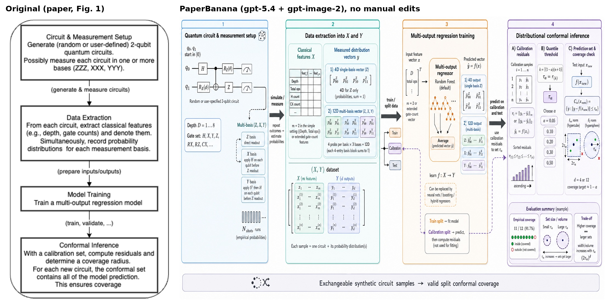
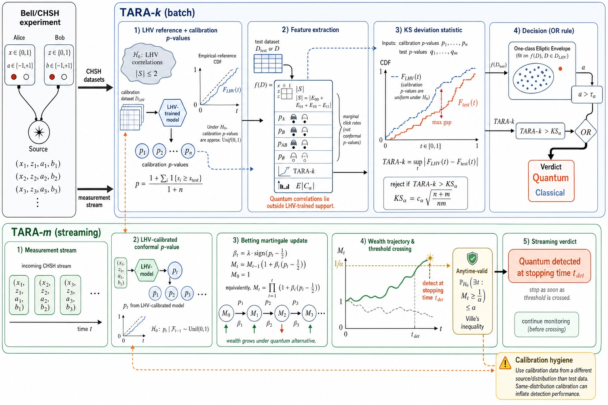
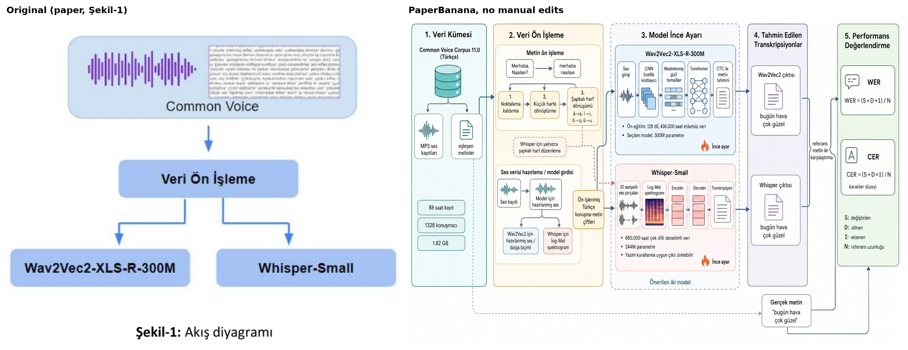

# PaperBanana field test

A hands-on test of [PaperBanana](https://arxiv.org/abs/2601.23265), an agentic
pipeline that turns a paper's methodology text into an academic illustration,
on three of my own papers. This repository contains the generated figures
(unedited), side-by-side comparisons with the original figures, the exact
inputs, and a small runner to reproduce the results.

**Summary:** the figures are much better first drafts than I expected, but
none of them was ready to drop into a paper. Each still needed fixes that the
pipeline's own critic did not make, and one contained an invented number.

## What was tested

| | |
|---|---|
| Paper | Zhu et al., *PaperBanana: Automating Academic Illustration for AI Scientists*, [arXiv:2601.23265](https://arxiv.org/abs/2601.23265) |
| Official code | [google-research/papervizagent](https://github.com/google-research/papervizagent) (Apache-2.0, renamed PaperVizAgent) |
| Code used here | [dwzhu-pku/PaperBanana](https://github.com/dwzhu-pku/PaperBanana) at commit [`491fa29`](https://github.com/dwzhu-pku/PaperBanana/commit/491fa29b950cb6befbbd611133cf5cd5e0cb4dd3) (first author's repository, which adds OpenAI support) |
| Pipeline | Retriever → Planner → Stylist → Visualizer → Critic (`demo_full` mode) |
| Input per paper | Methodology section as plain text + figure caption (see `inputs/`) |

## Setup and deviations from the paper

- **Backend:** OpenAI instead of Gemini. `gpt-5.4` for all text/vision agents
  and `gpt-image-2` (1536×1024, quality high) for rendering. The paper used
  Gemini 3 Pro and Nano Banana Pro, so results reflect *PaperBanana's pipeline
  with OpenAI models*.
- **Lite retrieval:** by default the Retriever places the full methodology
  sections of the whole reference pool in a single prompt (~3M characters).
  Here each reference's methodology text was truncated to its first 600
  characters in the retrieval prompt only. The retrieval prompt and parsing
  are otherwise unchanged, and the Planner still receives full references.
  The paper's own ablation reports similar scores for random and semantic
  retrieval, so the quality impact should be small. Use `--retrieval auto`
  for the upstream behaviour.
- **3 critic rounds, one candidate per paper, no manual edits.** The authors
  recommend generating several candidates and picking the best; I did not, to
  keep costs down.

## Results

Costs are estimates computed from the token counts returned by the API at
OpenAI list prices on 2026-10-18. Each run made 6 text calls and 5 image calls.

| Paper | Cost (USD) | Wall time | Main issues |
|---|---|---|---|
| [Multi-output conformal prediction on quantum circuit data](results/qcp-multioutput-conformal) | 1.58 | 10.8 min | Invented an "empirical coverage 11/12 (91.7%)" panel that is not in the paper (and draws 9 dots, not 12); calibration arrow points the wrong way; train/test splits connect to nothing; one typo |
| [TARA: conformal anomaly detection for quantum correlations](results/tara-conformal-quantum) | 1.56 | 10.9 min | Minor: a meaningless glyph next to \|S\|; the verdict box does not show which branch leads to "Quantum" vs "Classical". The critic fixed a wrong KS comparison from the first render |
| [Turkish speech recognition: Whisper vs Wav2Vec2 (Turkish input)](results/tr-asr-whisper-wav2vec2) | 1.50 | 9.8 min | Added a CTC decoding block the method text does not describe; the stylist switched stage titles to English, which the critic later reverted |
| **Total** | **4.64** | | |

Most of the wall time is the five sequential image renders (about 95 s and
USD 0.18 each).

### Multi-output conformal prediction



### TARA (the paper has no method figure)



### Turkish ASR (Turkish input)



## Findings

- **Strong drafts.** All three figures kept the paper's structure and added
  correct detail from the text: measurement bases and the split-conformal
  quantile and set definitions (paper 1), both TARA variants with correct
  formulas including Ville's inequality (paper 2), and correct Turkish labels
  and characters with dataset numbers matching the paper (paper 3).
- **Confident errors remain.** The worst case was an invented coverage number
  in a conformal-prediction figure. The critic saw it and only asked for an
  "example" label.
- **The critic is good at semantics, weak at connectivity.** It caught
  language drift and a wrong statistical comparison, but missed reversed
  arrows, dangling boxes and components the text never mentions. This matches
  the limitations the authors state in the paper, which call for human
  oversight.
- **Not free.** The code is open source, but every figure is a chain of paid
  API calls. With the upstream default (Gemini 3.1 Pro, full retrieval), I
  estimate retrieval alone at roughly USD 3 per figure from token counts and
  list prices; this was not measured.
- **Output is a raster image** (1536×1024), with no editable vector source.
  The final text description the pipeline writes is a useful brief for
  redrawing the figure in draw.io or TikZ.

Useful for: a first layout when a paper has no method figure, richer figures
for slides or posters, and figure specifications. Not suitable for direct use
in a submission without checking every arrow and number.

## Reproduce

Requires Python 3.12+, git, and your own OpenAI API key. Expect about
USD 1.50–1.60 and 10 minutes per paper with the default settings.

```bash
git clone https://github.com/detasar/paperbanana-field-test.git
cd paperbanana-field-test
scripts/setup.sh                      # clone upstream at the pinned commit, create .venv, download the reference set

export OPENAI_API_KEY="your-key-here" # set in your own shell; never commit it
scripts/reproduce.sh                  # all papers, or e.g. scripts/reproduce.sh tara-conformal-quantum
```

Outputs are written to `runs/<paper>/` (ignored by git): `generated_final.png`,
every intermediate render, the pipeline's text descriptions, per-call token
usage and a cost summary.

To run on your own paper:

```bash
.venv/bin/python run_paperbanana.py \
  --method-file path/to/method.txt \
  --caption-file path/to/caption.txt \
  --out-dir runs/my-paper
```

See `run_paperbanana.py --help` for all options (models, critic rounds,
candidates, retrieval mode).

## Repository layout

```
inputs/<paper>/       method.txt and caption.txt passed to the pipeline
results/<paper>/      generated_final.png, compare_original_vs_generated.png, original figure
run_paperbanana.py    wrapper around the upstream pipeline (usage logging, lite retrieval)
scripts/setup.sh      clones upstream at the pinned commit and installs dependencies
scripts/reproduce.sh  runs the field test for one or more papers
```

## License

Code: MIT (see `LICENSE`). Generated figures: CC BY 4.0. Original figures and
input excerpts remain under their arXiv licenses; see
[`LICENSE-CONTENT.md`](LICENSE-CONTENT.md) for details and attribution.
PaperBanana itself is Apache-2.0 and is not redistributed here.
